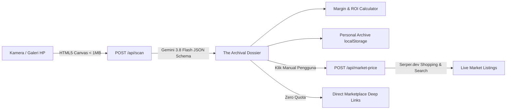

# THRIFTSCAN AI — Maison d'Expertise

> **Luxury Archival & Vintage Garment Appraisal** berbasis AI Vision dan valuasi pasar *real-time*.

**ThriftScan AI** adalah aplikasi web *mobile-first* untuk kurasi, identifikasi keaslian, estimasi era, dan valuasi harga pakaian *vintage* / *thrifting*. Dirancang dengan estetika **"Quiet Luxury & Maison Curatorial"** yang terinspirasi dari direktori editorial Hermès—mengutamakan kontras tinggi di bawah pencahayaan luar ruang, pengoperasian satu tangan (*one-thumb friendly*), dan arsitektur hemat kuota API.

---

## Fitur Utama

- **Dual-Frame Curatorial Scanner (`3:4` Editorial Portrait)**
  - **I. Garment Silhouette (Wajib):** Menganalisis potongan keseluruhan, grafis, *fading*, dan detail konstruksi pakaian.
  - **II. Neck Tag / Care Label (Disarankan):** Menganalisis tipografi label merek, kode RN/CA, negara pembuat (*Made in USA/Japan/Italy*), serta konstruksi jahitan (*single-stitch* vs *double-stitch*).
- **Client-Side Canvas Compression**
  - Setiap foto otomatis di-resize (maksimal `1024px`) dan dikompresi (`JPEG 0.7`, `< 1MB`) langsung di browser menggunakan HTML5 `<canvas>` sebelum dikirim ke server.
- **Smart 2-Step Quota Architecture**
  - **Tahap 1 — Instant AI Vision Appraisal (`gemini-3.8-flash`):** Menghasilkan *The Archival Dossier* lengkap dengan status kurasi (`PASS`, `CONSIDER`, `ACQUIRE`, `ARCHIVAL GRAIL`), rentang harga pasar sekunder Indonesia (IDR), serta poin *Craftsmanship & Authenticity Clues*.
  - **Tahap 2 — Live Market Valuation (`Serper.dev`):** Pencarian harga pasar aktif (Tokopedia, Carousell, Grailed, eBay, Vestiaire Collective) **hanya dipicu secara manual** saat pengguna menekan tombol *"Lihat Harga Pasar Saat Ini"* untuk menghemat kuota API.
- **Margin & Acquisition Calculator**
  - Kalkulator interaktif dengan *preset* harga beli cepat (`35rb`–`250rb`), estimasi profit bersih (setelah potongan ~8% biaya admin/packing), dan perhitungan *Return on Investment* (ROI).
- **Direct Marketplace Deep Links (Zero API Quota)**
  - Tautan pencarian instan ke Carousell ID, Tokopedia, Grailed, eBay Vintage, dan Vestiaire Collective yang tetap berfungsi meskipun tanpa kunci API Serper.
- **Personal Archive (`localStorage`)**
  - Menyimpan riwayat kurasi beserta *thumbnail* ringan di perangkat pengguna untuk perbandingan koleksi tanpa memotong kuota API.

---

## Arsitektur Alur Kerja



---

## Tech Stack

| Lapisan | Teknologi |
| :--- | :--- |
| **Framework** | Next.js 15 (App Router) + React 19 + TypeScript |
| **Styling & UI** | Tailwind CSS v4 + Lucide React |
| **Typography** | `Cormorant Garamond` (Serif), `Plus Jakarta Sans` (Sans), `JetBrains Mono` (Mono) |
| **AI Vision Engine** | Google Gen AI SDK (`@google/genai`) — Model `gemini-3.8-flash` |
| **Live Market Search** | Serper.dev Google Shopping & Search API |
| **Client Persistence** | Browser `localStorage` dengan kompresi *thumbnail* otomatis |

---

## Sistem Desain (Hermès Editorial Palette)

| Token | Hex | Penggunaan |
| :--- | :--- | :--- |
| **Canvas (Background)** | `#F6F1EB` | Latar utama halaman (*Warm Alabaster / Cream*) |
| **Surface (Card)** | `#FAF8F5` | Kartu *Archival Dossier* & bingkai kurasi (*Pure Ivory*) |
| **Primary Text** | `#1E1E1C` | Judul editorial, nama *Maison/Brand*, dan teks utama (*Deep Espresso*) |
| **Secondary Text** | `#6E6A64` | Label bagian *uppercase* & keterangan (*Warm Taupe*) |
| **Brand Accent** | `#F37021` | Aksen utama, indikator fokus, dan tombol CTA (*Hermès Orange*) |
| **Hairline Border** | `#E2DCD3` | Garis pemisah tipis `1px solid` (*Warm Sand*) |

---

## Struktur Direktori

```text
.
├── src/
│   ├── app/
│   │   ├── api/
│   │   │   ├── scan/
│   │   │   │   └── route.ts          # Tahap 1: Gemini 3.8 Flash Vision Appraisal
│   │   │   └── market-price/
│   │   │       └── route.ts          # Tahap 2: Serper.dev Live Market Valuation
│   │   ├── globals.css               # Konfigurasi tema & token warna Hermès
│   │   ├── layout.tsx                # Konfigurasi Google Fonts & metadata
│   │   └── page.tsx                  # Halaman utama (Scanner, Dossier, Personal Archive)
│   ├── components/
│   │   ├── ImageUploader.tsx         # 2 bingkai foto 3:4 + kompresi kanvas klien
│   │   ├── ScanResultCard.tsx        # Kartu hasil kurasi (The Archival Dossier)
│   │   ├── ProfitCalculator.tsx      # Kalkulator akuisisi, margin bersih & ROI
│   │   ├── LiveMarketList.tsx        # Katalog harga Serper.dev + Direct Deep Links
│   │   └── ScanHistory.tsx           # Grid riwayat kurasi dari localStorage
│   ├── lib/
│   │   ├── format.ts                 # Formatter mata uang Rupiah (IDR)
│   │   └── imageCompression.ts       # Utilitas resize & kompresi gambar HTML5 Canvas
│   └── types/
│       └── thrift.ts                 # Kontrak TypeScript (ThriftScanResult, MarketListing)
├── .env.example                      # Template variabel environment
├── hermes_ui_design_system.md        # Panduan lengkap sistem desain UI
├── product_requirements_document.md  # Dokumen spesifikasi produk (PRD)
└── technical_architecture_api_specs.md # Spesifikasi teknis & kontrak API
```

---

## Panduan Instalasi & Menjalankan Secara Lokal

### 1. Prasyarat
- **Node.js** `v20+` dan **npm**
- Kunci API **Google AI Studio** ([Dapatkan di sini](https://aistudio.google.com/apikey))
- Kunci API **Serper.dev** ([Dapatkan di sini](https://serper.dev/)) — *Opsional, fitur scan dan tautan marketplace tetap berjalan tanpa kunci ini*

### 2. Clone & Instalasi Dependensi

```bash
git clone https://github.com/username/ThriftScan.git
cd ThriftScan
npm install
```

### 3. Konfigurasi Environment Variables

Salin file `.env.example` menjadi `.env.local`:

```bash
cp .env.example .env.local
```

Isi variabel berikut di dalam `.env.local`:

```env
GEMINI_API_KEY="AIzaSyYourGoogleAIStudioKey"
SERPER_API_KEY="your_serper_dev_api_key"
```

### 4. Jalankan Server Pengembangan

```bash
npm run dev
```

Buka [http://localhost:3000](http://localhost:3000) di browser (atau akses melalui ponsel di jaringan lokal yang sama untuk mencoba pengalaman pemindaian kamera langsung).

### 5. Build untuk Produksi

```bash
npm run build
npm run start
```

---

## Spesifikasi Kontrak API

### 1. `POST /api/scan`
Menerima 1–2 gambar dalam format Base64 Data URL dan mengembalikan objek `ThriftScanResult`.

**Request Body:**
```json
{
  "images": [
    "data:image/jpeg;base64,/9j/4AAQSkZJRg...",
    "data:image/jpeg;base64,/9j/4AAQSkZJRg..."
  ]
}
```

**Response (`200 OK`):**
```json
{
  "id": "b6d9f1a2-4c3e-4a1b-9e2f-8a7c6d5e4f3a",
  "timestamp": 1729248000000,
  "brand": "Carhartt WIP / USA Workwear",
  "item_name": "J97 Detroit Blanket-Lined Duck Canvas Jacket",
  "category": "Archival Workwear / Outerwear",
  "estimated_era": "Late 1990s Archival (Made in USA)",
  "worth_level": "JACKPOT",
  "worth_reason": "Artikel J97 dengan kerah korduroi kontras dari akhir era 1990-an memiliki permintaan kolektor global yang sangat tinggi.",
  "authenticity_clues": [
    "Patch kulit persegi Carhartt pada dada kiri dengan patina alami.",
    "Label bordir leher mencantumkan RN 14806 dan Made in U.S.A.",
    "Ritsleting kuningan berat berlogo YKK USA."
  ],
  "estimated_price_idr": {
    "low": 2400000,
    "average": 3650000,
    "high": 5200000
  },
  "search_keyword_global": "Vintage 90s Carhartt J97 Detroit Jacket USA",
  "search_keyword_local": "Jaket Carhartt Detroit J97 Vintage Second"
}
```

### 2. `POST /api/market-price`
Mencari referensi harga pasar aktif dari katalog lokal dan global berdasarkan hasil identifikasi AI.

**Request Body:**
```json
{
  "keyword_global": "Vintage 90s Carhartt J97 Detroit Jacket USA",
  "keyword_local": "Jaket Carhartt Detroit J97 Vintage Second"
}
```

**Response (`200 OK`):**
```json
{
  "listings": [
    {
      "title": "Vintage 90s Carhartt J97 Moss Detroit Blanket Lined Jacket",
      "source": "Grailed",
      "price": "$285.00",
      "link": "https://www.grailed.com/listings/...",
      "thumbnail": "https://..."
    }
  ]
}
```

---

## Lisensi

Proyek ini didistribusikan untuk keperluan kurasi, edukasi, dan pengembangan aplikasi *archival appraisal*.
